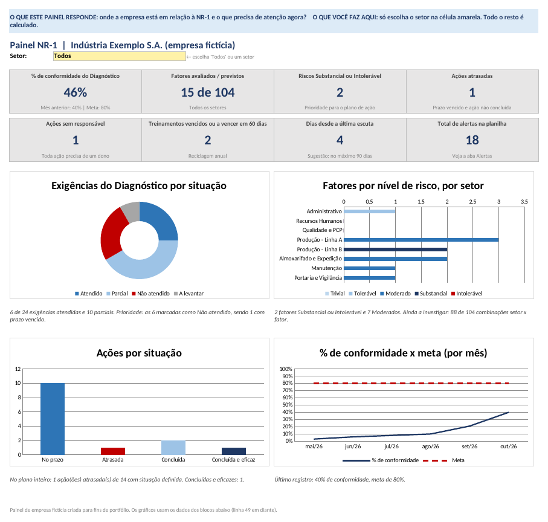
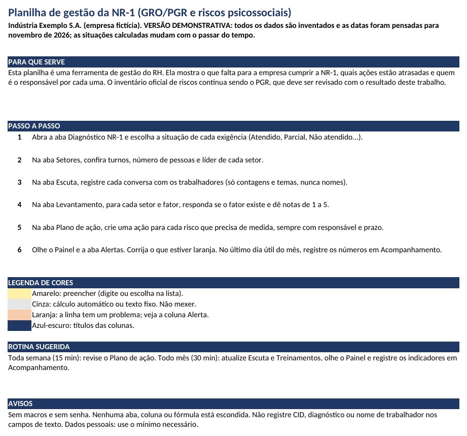
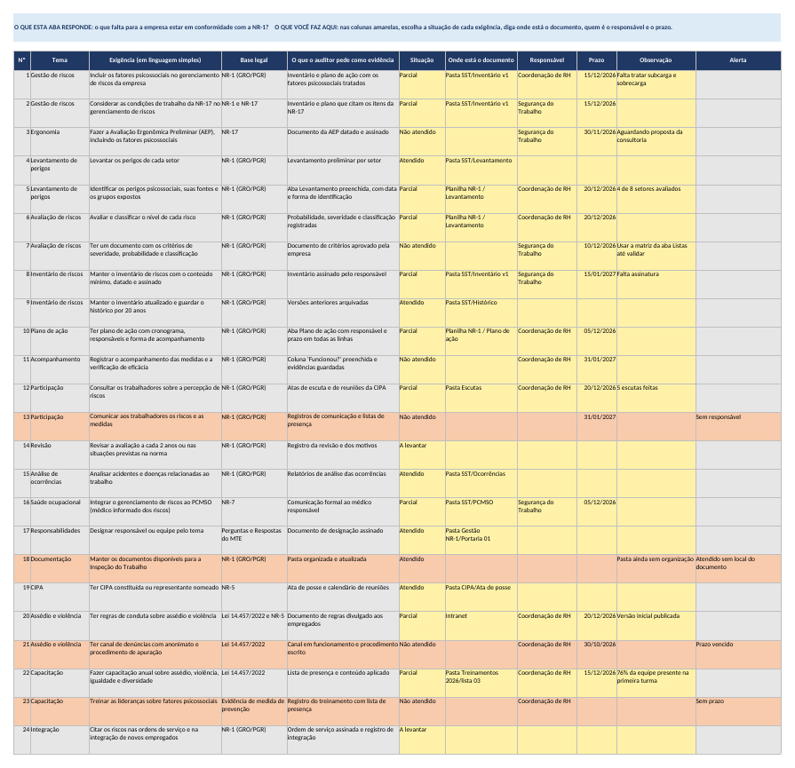
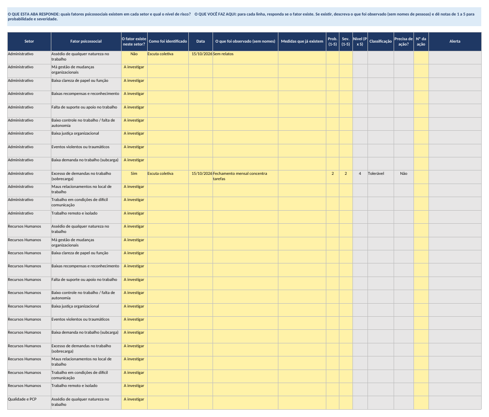
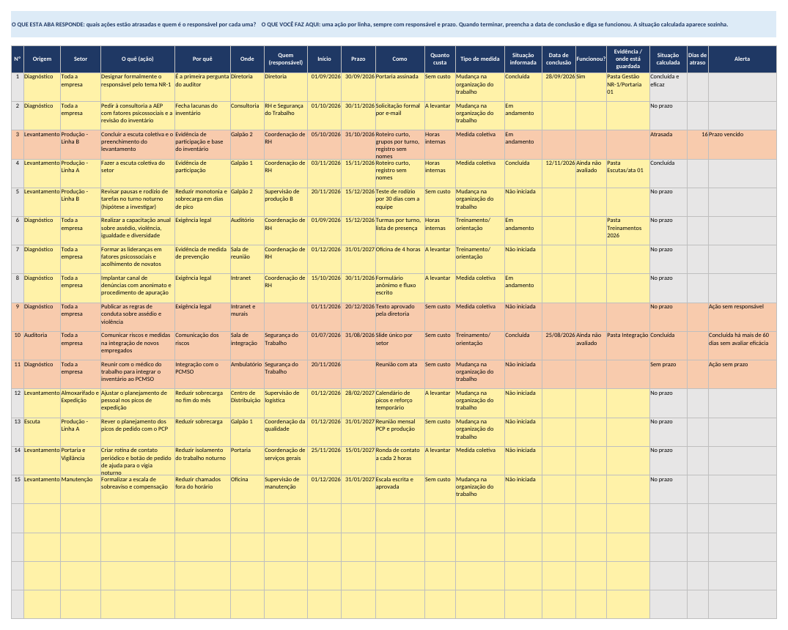
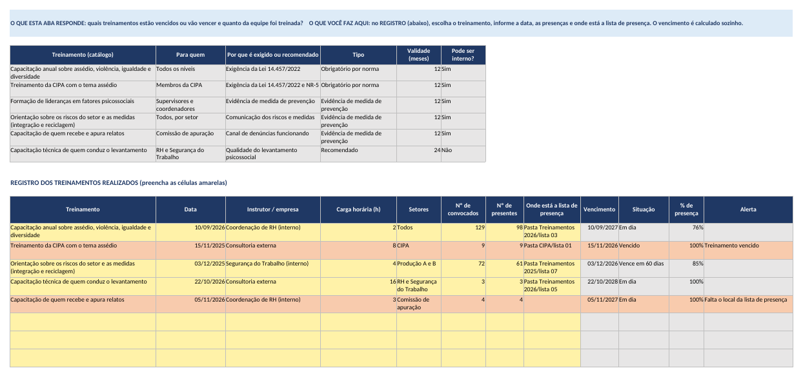
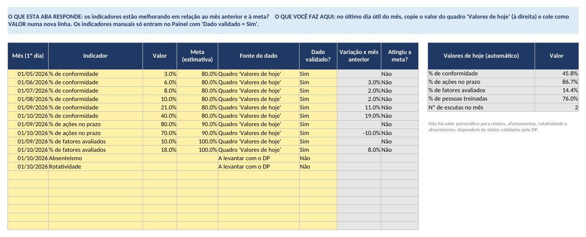
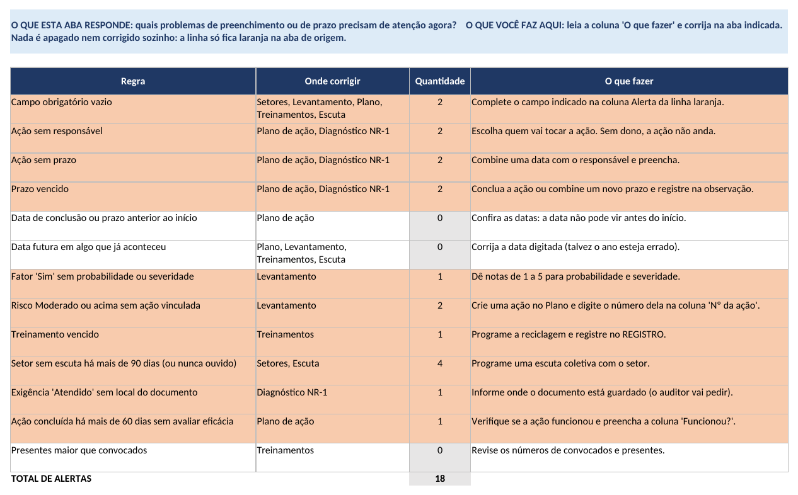

# Gestão da NR-1 (GRO/PGR e riscos psicossociais) em Excel

Planilha de gestão para o RH acompanhar a adequação de uma empresa à **NR-1**, incluindo o gerenciamento de **riscos psicossociais**, com análise e plano de ação em 5W2H.

> **Empresa fictícia.** Todo o conteúdo usa a "Indústria Exemplo S.A.", criada para este repositório. Setores, números, datas e registros são inventados. Nenhum documento, dado ou nome de empresa real foi usado.

## A pergunta de gestão

**O que falta para a empresa estar em conformidade com a NR-1, e quais ações estão atrasadas?**

A planilha foi pensada para profissionais de RH e DP com pouca familiaridade com Excel. Quem preenche só digita nas células amarelas; todo o resto (indicadores, alertas, painel) é calculado sozinho.

## Conclusão da empresa fictícia (versão demonstrativa)

- **46% de conformidade:** 6 de 24 exigências atendidas, 10 parciais, 6 não atendidas e 2 ainda a levantar.
- **15 de 104** combinações setor x fator psicossocial já avaliadas; 2 riscos classificados como Substancial (turno noturno da Linha B, hipóteses a investigar).
- **18 alertas abertos**, entre eles: 1 ação atrasada, 2 ações sem responsável, 1 treinamento vencido e 4 setores nunca ouvidos.
- Prioridades: designar responsável e fechar a lacuna de ergonomia (AEP), ouvir todos os setores, e dar dono e prazo a toda ação.

Detalhes e o plano completo: [`docs/analise-e-plano.md`](docs/analise-e-plano.md).

## Painel



| Gráfico | Por que este tipo |
|---|---|
| Rosca: exigências por situação | Mostra parte de um todo (quanto já foi atendido). |
| Barras horizontais empilhadas: fatores por nível de risco, por setor | Compara categorias com nomes longos e mostra onde o risco se concentra. |
| Colunas: ações por situação | Destaca o atraso ao lado do que está no prazo. |
| Linha: conformidade x meta, por mês | Mostra a tendência no tempo contra a meta (estimativa a validar). |

Cada gráfico tem uma frase de leitura automática logo abaixo e o seletor de setor filtra os cartões.

## Abas da planilha

| Aba | O que responde |
|---|---|
| Como usar | Passo a passo, legenda de cores, rotina semanal e mensal |
| Painel | Onde estamos e o que pede atenção agora |
| Diagnóstico NR-1 | O que falta para a conformidade (24 exigências) |
| Setores | Setores, turnos, pessoas e há quanto tempo cada um foi ouvido |
| Levantamento | Que fatores psicossociais existem em cada setor e em que nível |
| Plano de ação | O que será feito, por quem e até quando (5W2H) |
| Treinamentos | Catálogo, registro e vencimentos |
| Escuta | Registro das conversas com os trabalhadores (sem nomes) |
| Acompanhamento | Indicadores mensais contra a meta |
| Alertas | Problemas de preenchimento e de prazo, contados por regra |
| Listas, Premissas, Log | Listas suspensas, regras adotadas e histórico de construção |

<details>
<summary>Ver prints das abas</summary>

**Como usar**



**Diagnóstico NR-1**



**Levantamento psicossocial**



**Plano de ação**



**Treinamentos**



**Acompanhamento mensal**



**Alertas**



</details>

## Decisões de design

1. **Poucas células para digitar:** amarelo = preencher, cinza = automático, laranja = problema. Listas suspensas em todo campo de escolha e validação de datas (dd/mm/aaaa).
2. **Alertas em vez de correções automáticas:** a planilha destaca ação sem responsável, prazo vencido, data impossível, risco sem ação vinculada e mais. Ela nunca apaga nem corrige sozinha.
3. **Sem macros, sem senha, sem nada escondido.** Só funções do Excel 2016 em diante (SE, CONT.SES, SOMASES, ÍNDICE, CORRESP, DATAM, HOJE).
4. **Privacidade:** nenhum campo pede CID, diagnóstico ou nome de trabalhador. Escutas registram só contagens e temas.
5. **Premissas e Log visíveis:** toda regra provisória está na aba Premissas (por exemplo, a matriz de risco 5x5 e as metas, marcadas como estimativa).
6. **Hipótese não é acusação:** observações como "tarefa repetitiva no turno noturno" aparecem como hipótese a investigar, nunca como culpa de pessoas.

## Arquivos

```
planilha/NR1_Industria_Exemplo_DEMO.xlsx   versão com dados fictícios de demonstração
planilha/NR1_Modelo_Vazio.xlsx             mesma estrutura, sem registros (modelo para adaptar)
scripts/gerar_planilha.py                  script em Python (openpyxl) que gera as duas planilhas
docs/analise-e-plano.md                    análise e planejamento da empresa fictícia
docs/img/                                  prints
```

## Como regenerar

```bash
pip install openpyxl
python scripts/gerar_planilha.py
```

O script grava as fórmulas com nomes em inglês (IF, COUNTIFS, INDEX), e o Excel em português as mostra como SE, CONT.SES e ÍNDICE. Para recalcular os valores antes de abrir em visualizadores que não calculam, abra e salve no Excel ou no LibreOffice.

## Limitações e cuidados

- A versão demonstrativa usa datas de novembro de 2026. Como o arquivo usa `HOJE()`, as situações "Atrasada", "Vencido" e "Dias desde a última escuta" mudam com o tempo.
- Os prints foram gerados no LibreOffice; no Excel a aparência pode variar um pouco.
- A matriz de risco 5x5 é provisória e didática. Em uso real, deve ser a mesma do PGR da empresa, validada por quem o elabora.
- As bases legais citam o nome da norma. Confira o item exato no texto vigente antes de usar em documento oficial.
- O **#N/D** que aparece nos dados dos gráficos (Painel, linhas 76 a 81) é intencional: faz o gráfico de linha pular meses sem registro.
- Esta planilha é uma ferramenta de apoio à gestão. Ela **não substitui** o PGR, o inventário de riscos nem a avaliação feita por profissional habilitado.

## Licença

[MIT](LICENSE). Todo o conteúdo é fictício e livre para adaptação.

<!--
## Autor
Adicione aqui seu nome, cargo e link do LinkedIn.
-->
